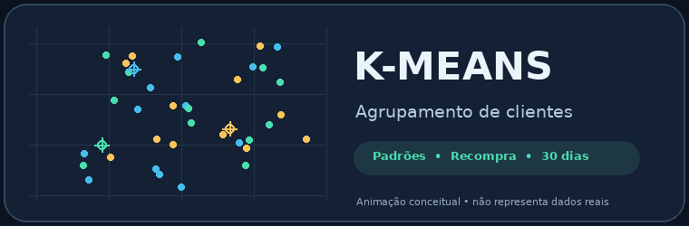
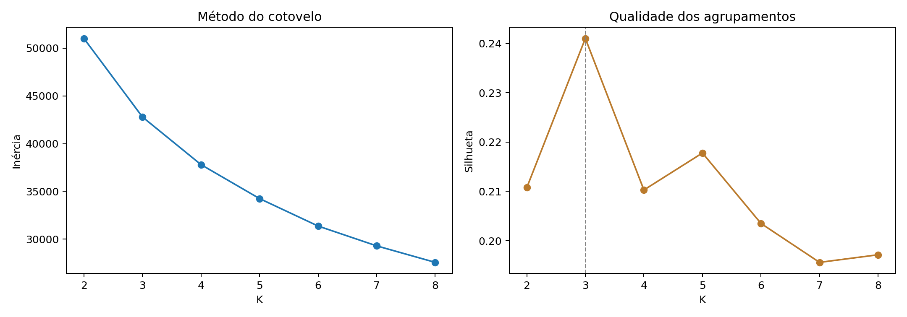
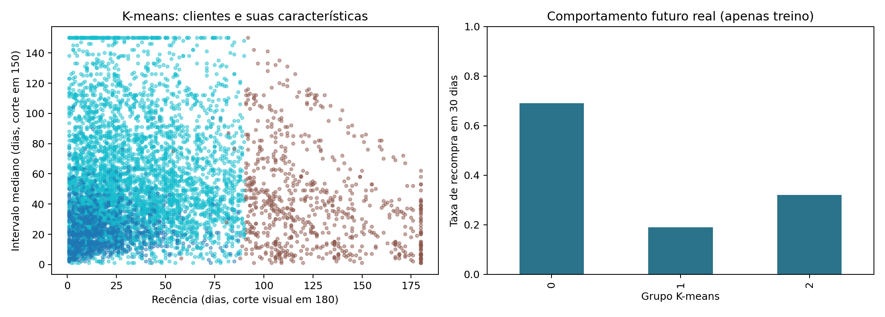
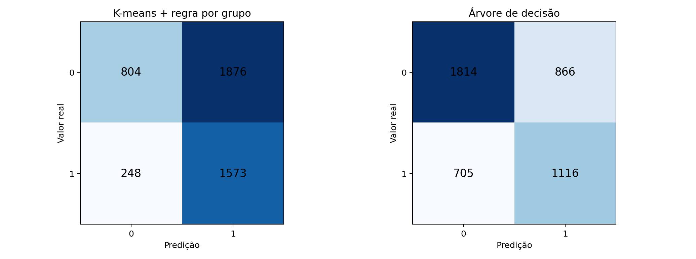
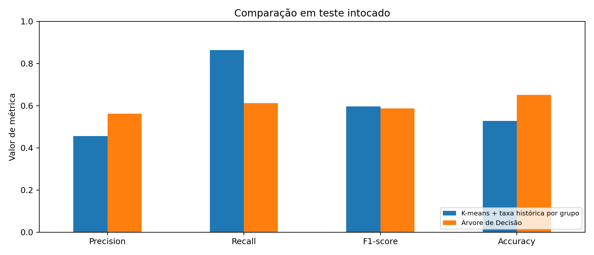

<div align="center">

# 🛍️ Quando comprar novamente?

### Segmentação de clientes e identificação de janelas de recompra com K-means



<p>
  
  
  
  
</p>

**[📓 Notebook](notebooks/Projeto_Final.ipynb) · [📈 Resultados](resultados/graficos/) · [📄 Relatório](relatorio/Relatorio_Final.pdf) · [🎤 Apresentação](apresentacao/Apresentacao_Final.pptx)**

</div>

---

## 💡 O problema

É possível identificar **quando um cliente tem maior propensão a comprar novamente** usando seu histórico de compras? O projeto agrupa comportamentos semelhantes pelo **K-means**, calcula a taxa histórica de recompra dos grupos e avalia a indicação de uma **janela de 30 dias**.

> **Escopo:** a previsão diz respeito à **probabilidade de uma nova compra**, e **não** ao menor preço de um produto, à previsão de um SKU específico ou a uma compra garantida.

<div align="center">
  
  
  
</div>

*Os GIFs acima são **ilustrações conceituais originais**; os gráficos e métricas abaixo são calculados a partir da base real.*

## 🔍 O que foi desenvolvido

| Etapa | Abordagem |
|---|---|
| Dados | Leitura **integral** da base Online Retail da UCI, com auditoria dos registros |
| Preparação | Tratamento de cancelamentos, identificadores ausentes e operações inválidas |
| Engenharia de atributos | Recência, frequência, valor de compras, intervalos, comportamento recente |
| **Modelo principal** | **K-means**, com seleção de K por critérios de agrupamento |
| Comparação | **Árvore de Decisão** supervisionada para recompra nos próximos 30 dias |
| Validação | Separação cronológica, métricas classificatórias, matrizes de confusão e curvas ROC |

## 📦 Dados e resultados reais

Os dados vêm do **[UCI Machine Learning Repository — Online Retail](https://archive.ics.uci.edu/dataset/352/online+retail)**, que descreve compras de uma varejista britânica entre dezembro de 2010 e dezembro de 2011. A planilha original está incluída em [`dados/Online Retail.xlsx`](dados/Online%20Retail.xlsx).

| Indicador | Valor |
|---|---:|
| Linhas originais | **541.909** |
| Linhas válidas após os filtros | **392.692** |
| Clientes identificados após limpeza | **4.338** |
| Fotografias cliente-data | **12.926** |
| Treino / validação / teste | **6.535 / 1.890 / 4.501** |
| Clusters selecionados | **3** |

Os números acima foram obtidos da execução fornecida no projeto. Não foram geradas transações artificiais. A seleção de K empregou amostragem apenas para a estimativa de silhueta; o ajuste final do K-means utilizou todas as observações de treinamento.

### 📊 Comparação em teste cronológico

| Modelo | Precisão | Recall | F1-score | Acurácia |
|---|---:|---:|---:|---:|
| **K-means + taxa histórica por grupo** | 45,61% | **86,38%** | **59,70%** | 52,81% |
| Árvore de Decisão | **56,31%** | 61,29% | 58,69% | **65,10%** |
| Regra: sempre recomendar recompra | 40,46% | 100,00% | 57,61% | 40,46% |

O **K-means obteve maior recall e F1** entre os dois modelos de aprendizado avaliados; a árvore apresentou maior precisão e acurácia. Essas métricas se referem exclusivamente ao período de teste histórico, não a compras em tempo real.

### 🖼️ Visualizações geradas com os dados reais

<table>
  <tr>
    <td width="50%"><a href="resultados/graficos/05_escolha_k.png"></a><br /><b>Seleção de K</b></td>
    <td width="50%"><a href="resultados/graficos/06_perfis_clusters.png"></a><br /><b>Perfis identificados</b></td>
  </tr>
  <tr>
    <td><a href="resultados/graficos/07_matrizes_confusao.png"></a><br /><b>Matrizes de confusão</b></td>
    <td><a href="resultados/graficos/08_metricas_comparadas.png"></a><br /><b>Desempenho dos modelos</b></td>
  </tr>
</table>

A pasta [`resultados/graficos/`](resultados/graficos/) reúne **10 gráficos** e [`resultados/tabelas/`](resultados/tabelas/) contém as tabelas CSV de auditoria, métricas e previsões.

## 📁 Organização do repositório

```text
Projeto-Final-de-Machine-Learning/
├── assets/
│   └── animacoes/                  # GIFs do README
├── dados/
│   └── Online Retail.xlsx          # base real integral
├── notebooks/
│   ├── Projeto_Final.ipynb          # notebook para executar
│   └── Projeto_Final_EXECUTADO.ipynb # saídas registradas
├── resultados/
│   ├── graficos/                   # gráficos reais em PNG
│   └── tabelas/                    # CSVs de auditoria, métricas e previsões
├── relatorio/
│   ├── Relatorio_Final.docx
│   └── Relatorio_Final.pdf
├── apresentacao/
│   └── Apresentacao_Final.pptx
├── requirements.txt
├── .gitignore
└── README.md
```

## 🚀 Como reproduzir

**1. Clone o repositório e crie um ambiente virtual.**

```powershell
git clone https://github.com/Lightkiin/Projeto-Final-de-Machine-Learning.git
cd Projeto-Final-de-Machine-Learning
python -m venv .venv
.\.venv\Scripts\Activate.ps1
```

**2. Instale as dependências.**

```powershell
python -m pip install -r requirements.txt
```

**3. Abra o notebook.**

```powershell
jupyter notebook
```

Abra [`notebooks/Projeto_Final.ipynb`](notebooks/Projeto_Final.ipynb), selecione o kernel do ambiente criado e execute **Run All**. O notebook encontra automaticamente a base em `dados/` e salva os novos resultados nas pastas corretas, mesmo quando aberto dentro de `notebooks/`.

Para explorar resultados sem executar o pipeline novamente, abra [`notebooks/Projeto_Final_EXECUTADO.ipynb`](notebooks/Projeto_Final_EXECUTADO.ipynb). A execução original foi validada com Python 3.13.5, pandas 2.2.3 e scikit-learn 1.8.0. A primeira instalação das bibliotecas exige conexão, mas a base está incluída para a execução local.

## 🔁 Atualizar o repositório no GitHub

Se você já tem o repositório clonado, **copie o conteúdo desta versão organizada para a raiz do repositório**, substituindo os arquivos antigos. Preserve a pasta `.git` que já existe no seu computador; ela não está incluída neste ZIP. Remova da raiz os arquivos antigos que foram transferidos para as novas pastas e, então, execute:

```powershell
git add -A
git status
git commit -m "Organiza arquivos e adiciona README com GIFs"
git push origin main
```

O Git reconhecerá os arquivos movidos quando possível. O `.gitignore` impede que ambientes virtuais como `env/` ou `.venv/` sejam adicionados.

## 📖 Fundamentação e fontes

1. **Chen, D.; Sain, S. L.; Guo, K. (2012).** *Data mining for the online retail industry: A case study of RFM model-based customer segmentation using data mining*. **Journal of Database Marketing & Customer Strategy Management**, 19(3), 197–208. [DOI](https://doi.org/10.1057/dbm.2012.17). Contribuição: segmentação RFM com K-means e interpretação de perfis de clientes.
2. **Fader, P. S.; Hardie, B. G. S.; Lee, K. L. (2005).** *“Counting Your Customers” the Easy Way: An Alternative to the Pareto/NBD Model*. **Marketing Science**, 24(2), 275–284. [DOI](https://doi.org/10.1287/mksc.1040.0098). Contribuição: análise do comportamento de recompra a partir do histórico de transações; o modelo probabilístico do artigo não foi implementado neste trabalho.
3. **UCI Machine Learning Repository.** [Online Retail](https://archive.ics.uci.edu/dataset/352/online+retail) (licença CC BY 4.0).

## 👨‍💻 Autor

**Brendon Córdova Silveira** · Engenharia da Computação · Projeto Final de Machine Learning

<div align="center">

⭐ Se o projeto foi útil, explore os notebooks e os gráficos para acompanhar cada etapa da análise.

</div>
